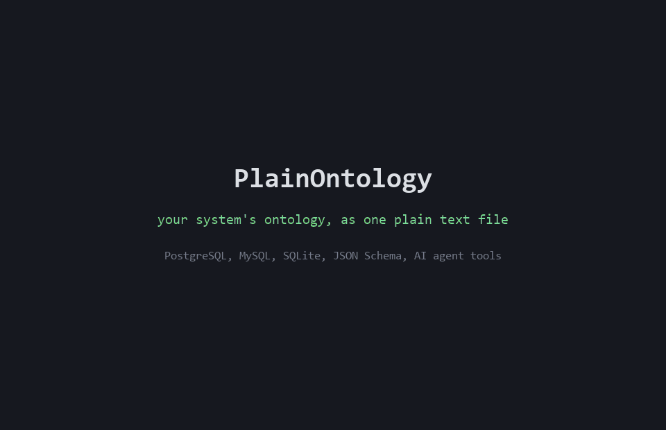

# PlainOntology

[](https://github.com/cfuracao-academic/plainontology/actions/workflows/ci.yml)
[](https://pypi.org/project/plainontology/)
[](pyproject.toml)
[](LICENSE)
[](https://doi.org/10.5281/zenodo.24562420)

**Write down the ontology your system already has, as one plain text file that people can edit and AI agents can read.**

**Try it:** `pip install plainontology`, then `plainonto init my.onto --from sqlite:my.db`



Every running system carries an implicit ontology: tables and foreign keys, JSON schemas, the tool definitions an LLM agent calls. Its meaning (what a "loan" is, that a "Title" is a "Book", that `member` holds personal data) usually lives in people's heads. PlainOntology extracts the structure into a readable text file, keeps your hand-written meaning next to it, and tells you when the system drifts away from it.

```text
concept Book [auto: sqlite table books]
  has id : integer key [auto]
  has title : text required [auto]
  has isbn : text unique "ISBN-13 without hyphens."
  author -> Author required [auto: fk books.author_id]
  tags -> Tag many [auto: via book_tags]
  definition "A title the library holds; one record per edition."
  synonym "Title"
  same_as schema:Book
```

Lines tagged `[auto]` come from the sources and are refreshed. **Every other line is yours and is never overwritten.**

## What it does

| | |
|---|---|
| **Extract** | SQLite databases or `.sql` schema files, JSON Schema (draft 7 and 2020-12), and LLM tool definitions (Anthropic, OpenAI Chat and Responses, MCP `tools/list`) |
| **Keep your edits** | Refresh replaces `[auto]` lines only. If you rewrite an extracted line, your version wins and is reported |
| **Report drift** | `plainonto drift` exits 1 when the sources changed, so it can gate CI |
| **Check** | Duplicate lines, unknown targets, undeclared prefixes, proposals waiting for review |
| **Validate** | Check JSON records (for example an agent's structured output) against a concept |
| **Export** | RDF Turtle (OWL structure, SKOS meaning) and LinkML YAML |
| **Serve to agents** | An MCP server so agents look concepts up, validate their output, and propose new lines for a person to review |

The core has no dependencies beyond the Python standard library. The MCP server needs the `mcp` extra.

## Quick start

```bash
pip install "plainontology[mcp]"

cd examples
plainonto init library.onto --from sqlite:library.sql --from tools:agent-tools.json
# edit library.onto: add definitions, synonyms, same_as mappings
plainonto refresh library.onto       # re-extract; your lines stay
plainonto drift library.onto         # report only; exit 1 on drift
plainonto check library.onto
plainonto export library.onto --to turtle -o library.ttl
plainonto export library.onto --to linkml -o library.yaml
plainonto validate library.onto Loan record.json
```

The command is `plainonto` (short for `plainontology`; both work).

Sources are written `KIND:PATH` and stored in the file, relative to it:

| Kind | Path |
|---|---|
| `sqlite` | a SQLite database, or a `.sql` schema file (loaded into memory) |
| `jsonschema` | a JSON Schema file; `$defs` and nested objects become concepts. For Pydantic, dump `Model.model_json_schema()` first |
| `tools` | a JSON list of tool definitions, or an object with a `tools` list |

## Use it from an AI agent (MCP)

```bash
plainonto mcp path/to/library.onto                    # read-only tools
plainonto mcp path/to/library.onto --allow-proposals  # also lets agents propose lines
```

Claude Code:

```bash
claude mcp add plainontology -- plainonto mcp /absolute/path/to/library.onto
```

Claude Desktop or any MCP client (`mcpServers` in the client's config):

```json
{
  "mcpServers": {
    "plainontology": { "command": "plainonto", "args": ["mcp", "/absolute/path/to/library.onto"] }
  }
}
```

| Tool | What it does |
|---|---|
| `list_concepts` | every concept with its definition |
| `describe_concept` | a concept's lines, inherited properties and who points to it |
| `search` | find concepts by name, label, synonym, definition or property |
| `validate_record` | check a JSON object against a concept before acting on it |
| `drift` | compare the file with its sources now |
| `propose` | only with `--allow-proposals`: add a line tagged `[proposed]`; a person accepts it by deleting the tag |

The file is re-read on every call, so edits show up at once. Agents can never change or delete an existing line.

## Why a text file

* **Diffable.** Ontology changes go through pull requests like code.
* **Two layers in one place.** Structure (`has`, `->`, `is_a`) and meaning (`label`, `definition`, `synonym`, `same_as`, `note`) sit together, so neither drifts from the other.
* **Interoperable.** Export to OWL/SKOS and LinkML when you need the standard toolchains.

## How it compares

| | PlainOntology | LinkML | OWL editors (Protégé) | Data catalogues (DataHub, OpenMetadata) |
|---|---|---|---|---|
| Direction | extracts from a running system | you write the schema, it generates | you write the ontology | ingests metadata |
| Format | one plain text file | YAML | RDF/OWL | database behind a server |
| Keeps hand edits across re-extraction | yes | n/a | n/a | partly |
| LLM tool schemas and MCP | yes | no | no | no |
| Setup | `pip install` | `pip install` | desktop app | servers |

PlainOntology does not replace these. It exports to LinkML and OWL so you can move to them when you need more.

## Format

The full grammar and refresh rules are in [SPEC.md](SPEC.md). In short:

```text
prefix : <https://example.org/library#>
source sqlite:library.sql

concept NAME [auto: where it came from]
  has PROPERTY : TYPE [FLAGS] ["description"]
  PROPERTY -> CONCEPT [FLAGS] ["description"]
  is_a CONCEPT
  label "..."
  definition "..."
  synonym "..."
  note "..."
  same_as prefix:Term
```

Types: `text integer decimal boolean date datetime binary json any enum(a|b)`. Flags: `key required unique many`. The empty prefix line sets the base IRI for exports.

## Development

```bash
python -m venv .venv && .venv/bin/pip install -e ".[dev]"
pytest
```

See [CONTRIBUTING.md](CONTRIBUTING.md) and [ROADMAP.md](ROADMAP.md).

## Citing

If you use PlainOntology in research, please cite it using [CITATION.cff](CITATION.cff). The DOI [10.5281/zenodo.24562420](https://doi.org/10.5281/zenodo.24562420) always points to the latest version; each release also has its own DOI on Zenodo.

## Licence

MIT
