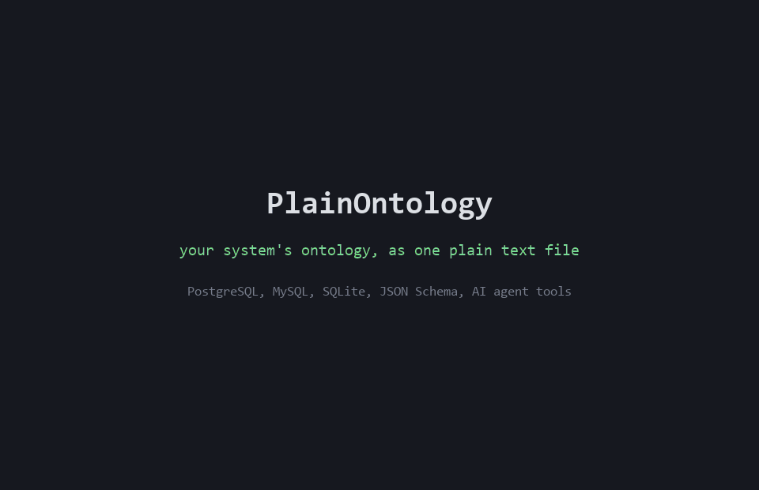

# PlainOntology

**Write down the ontology your system already has, as one plain text file that people can edit and AI agents can read.**

```bash
pip install plainontology
plainonto init my.onto --from sqlite:my.db
```



Every running system carries an implicit ontology: tables and foreign keys, JSON schemas, API descriptions, dbt models, the tool definitions an AI agent calls. Its meaning (what a "loan" is, that a "Title" is a "Book") usually lives in people's heads. PlainOntology extracts the structure into a readable text file, keeps your hand-written meaning next to it, and tells you when the system drifts away from it.

| | |
|---|---|
| **Sources** | PostgreSQL, MySQL, SQLite (live or dumps), JSON Schema, OpenAPI, dbt, AI agent tool definitions |
| **Your lines are safe** | Lines tagged `[auto]` are refreshed; every other line is yours and is never overwritten |
| **Drift in CI** | A GitHub Action and pre-commit hooks fail the check when the sources change |
| **Validate** | Check JSON records, for example an agent's output, against a concept |
| **Export** | OWL and SKOS (Turtle), SHACL shapes, LinkML |
| **Agents** | An MCP server to look concepts up, validate output and propose lines |

Start with the [tutorial](tutorial.md), or read the [file format](format.md).
